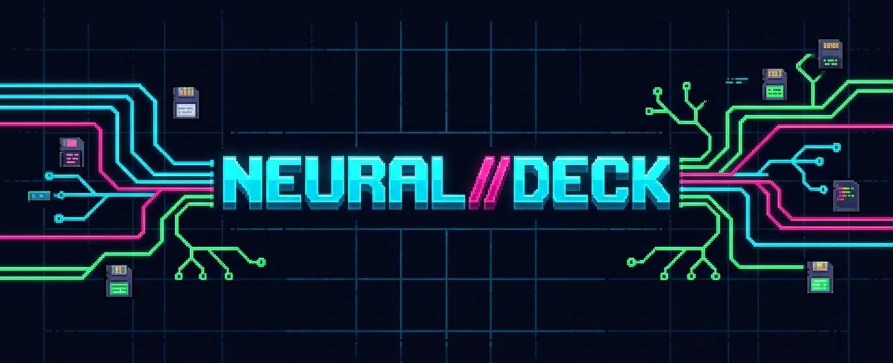
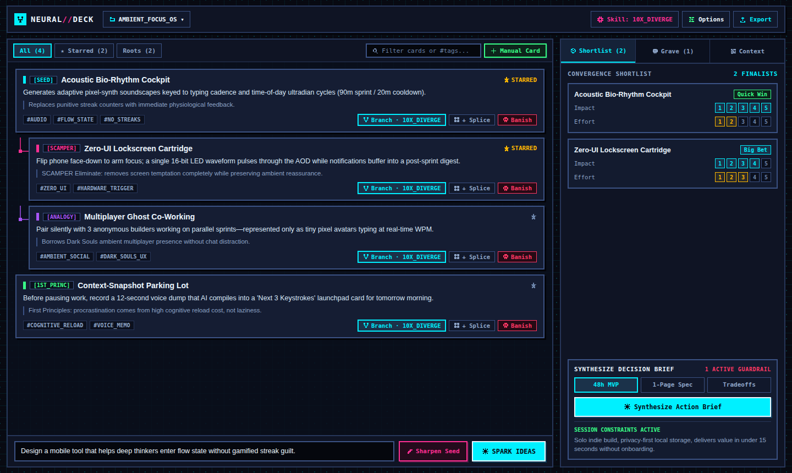
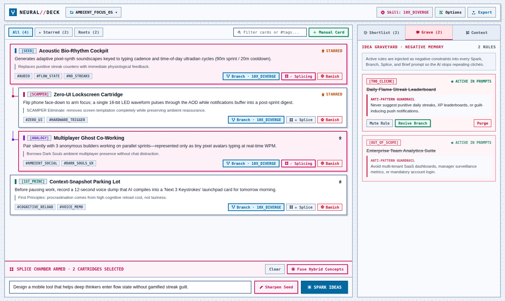
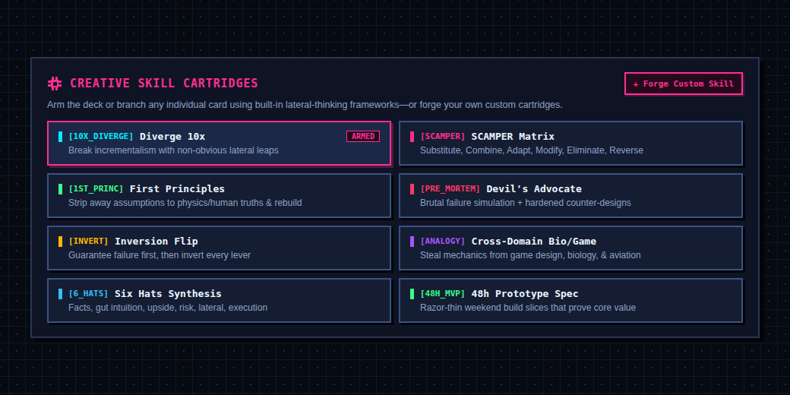
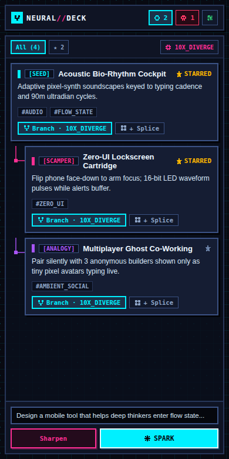
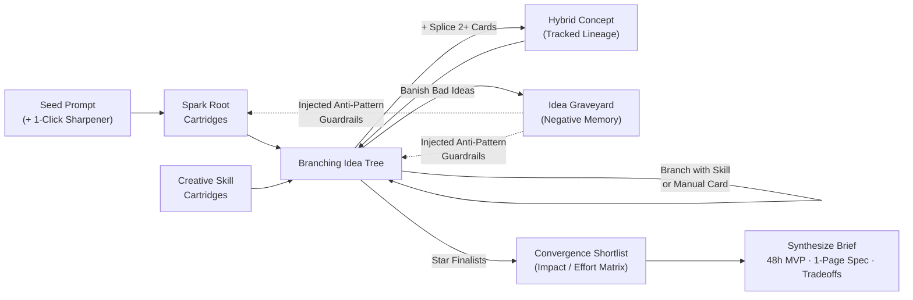

<div align="center">



<h3>Turn one spark into a hundred paths.<br/>Fuse the best. Bury the clichés.</h3>

<p>
  <strong>A pixel-art cyber-deck web &amp; Android application for non-linear, AI-assisted brainstorming.</strong>
</p>

<p>
  
  
  
  
  
</p>

<p>
  <a href="#why-neuraldeck">Why Neural Deck?</a> •
  <a href="#visual-tour">Visual Tour</a> •
  <a href="#how-it-works">How It Works</a> •
  <a href="#creative-skill-cartridges">Skills Deck</a> •
  <a href="#development">Development</a> •
  <a href="#android-app-apk">Android APK</a>
</p>

</div>

---

## Why NEURAL//DECK?

Most AI brainstorming happens inside a **linear chat scroll**. Good tangents get buried fifty messages up, every follow-up drifts back toward generic clichés, and turning a messy transcript into a concrete decision takes manual copy-pasting.

**NEURAL//DECK** replaces the chat box with a **branching cyber-deck workstation** (rewritten in React, TypeScript, Tailwind CSS, and Express from the original Android app):

- **Think in trees, not threads** — Spark root concept cartridges from a seed prompt, then branch any promising card into child subtrees connected by 90-degree neon circuit rails.
- **Steer with structured thinking frameworks** — Slot built-in lateral-thinking cartridges (`10X_DIVERGE`, `SCAMPER`, `1ST_PRINC`, `PRE_MORTEM`, and more) or forge your own custom skills.
- **Fuse unexpected hybrids** — Arm 2 or more cards in the **Splice Chamber** to collide separate branches into emergent concepts with tracked parent lineage.
- **Teach the AI what you hate** — Banish weak ideas into the **Idea Graveyard** with anti-pattern rules (`TOO_CLICHE`, `OUT_OF_SCOPE`, `WRONG_VIBE`, `DEAD_END`). Active rules become **negative memory** injected into every future AI prompt.
- **Converge to a shippable plan** — Star finalists, score them on Impact vs. Effort, and synthesize a ready-to-build `48h MVP`, `1-Page Spec`, or `Tradeoffs` brief.

---

## Visual Tour

### Midnight Cyber-Deck (Dark Mode) — Branching Tree & Convergence Shortlist

Spark concepts from the bottom Seed Dock, branch any card along neon circuit rails, and rate starred finalists in the right-hand **Convergence Shortlist** to auto-classify them (`Quick Win`, `Big Bet`, `Incremental`, `Reconsider`) before synthesizing an action brief.



---

### Daylight Technical Blueprint (Light Mode) — Splice Chamber & Idea Graveyard

Switch seamlessly to **Light Mode**, select multiple cartridges with `+ Splice` to fuse hybrid ideas, and manage banished concepts in the **Idea Graveyard** where active anti-pattern rules keep future generations sharp and cliché-free.



---

### Creative Skill Cartridges

Arm the deck—or branch a single card—with any of the 8 built-in thinking frameworks, add optional per-branch steering notes, or forge custom cartridges tailored to your domain.



---

### Mobile PWA & Native Android App

<table>
  <tr>
    <td width="300" valign="top">
      
    </td>
    <td valign="top">
      <h4>Brainstorm Anywhere — Offline-First</h4>
      <p>
        NEURAL//DECK adapts cleanly to phones as an installable <strong>Progressive Web App (PWA)</strong> and ships as a native <strong>Android APK</strong> via Capacitor.
      </p>
      <ul>
        <li><strong>Local-first persistence:</strong> Sessions, starred finalists, custom skills, and graveyard guardrails live in <code>localStorage</code> so you can review, edit, filter, and organize ideas offline.</li>
        <li><strong>Touch-ready workstation:</strong> Quick-access header counters jump straight to your Shortlist and Graveyard sheets, with hardware back-button support on Android.</li>
        <li><strong>Instant exports:</strong> Export full indented Markdown trees or JSON backups—opening the native share sheet on Android so you can send specs straight to Files or Drive.</li>
        <li><strong>Bring your own key on mobile:</strong> The Android build talks directly to Gemini or OpenRouter using API keys stored privately on-device.</li>
      </ul>
    </td>
  </tr>
</table>

---

## How It Works



1. **Sharpen & Spark**: Drop a rough prompt into the Seed Dock (or hit **Sharpen Seed** to tighten it into a crisp brief with 1-click `Revert`), then click **SPARK IDEAS** to generate root concept cartridges.
2. **Branch & Steer**: Click **Branch** on any card using your armed skill—or pick a different skill and add a steering note—to grow child nodes along 90-degree circuit rails. You can also author manual root/child cards and edit any card inline.
3. **Splice**: Toggle `+ Splice` on 2 or more cards across different branches and fuse them into emergent hybrid concepts that remember their parent lineage.
4. **Bury the Clichés**: Banish weak cards (and their subtrees) to the **Idea Graveyard** with a reason tag (`TOO_CLICHE`, `OUT_OF_SCOPE`, `WRONG_VIBE`, `DEAD_END`) and a custom rule. Every active rule is injected as negative memory into subsequent AI calls; you can mute rules, revive branches, or purge entries anytime.
5. **Converge & Ship**: Star your strongest contenders, rate them `1–5` on **Impact** and **Effort** in the Shortlist, and synthesize a structured **48h MVP**, **1-Page Spec**, or **Tradeoffs** decision brief.

---

## Creative Skill Cartridges

| Cartridge | Name | Mental Model |
| :--- | :--- | :--- |
| `[10X_DIVERGE]` | **Diverge 10x** | Break incrementalism with bold, non-obvious lateral leaps across mechanisms, audiences, or business models. |
| `[SCAMPER]` | **SCAMPER Matrix** | Mutate ideas with Substitute, Combine, Adapt, Modify, Eliminate, and Reverse operators. |
| `[1ST_PRINC]` | **First Principles** | Strip away legacy assumptions down to fundamental truths and rebuild cleaner solutions from scratch. |
| `[PRE_MORTEM]` | **Devil's Advocate** | Simulate catastrophic failure 12 months out and propose hardened counter-architectures. |
| `[INVERT]` | **Inversion Flip** | Charlie Munger–style inversion: guarantee failure first, then flip every lever upside down. |
| `[ANALOGY]` | **Cross-Domain Bio/Game** | Transfer proven mechanics from roguelikes, mycelial networks, aviation checklists, or markets. |
| `[6_HATS]` | **Six Hats Synthesis** | Combine De Bono's perspectives into an optimistic breakthrough, a data/system play, and a tactical pivot. |
| `[48H_MVP]` | **48h Prototype Spec** | Slice concepts into razor-thin weekend builds with Wizard-of-Oz shortcuts and falsifiable validation signals. |

Need a specialized lens (e.g., *Regulatory Stress-Test*, *Hardware BOM Minifier*, or *Viral Hook Generator*)? Open the Skills Deck and click **+ Forge Skill** to save reusable custom cartridges.

---

## Full Feature Breakdown

- **Branching Idea Tree**: Spark root concept cartridges from a seed prompt, branch any card into child nodes with 90-degree neon circuit rails (or add your own manual root/child cards), collapse/expand subtrees, edit cards inline, star finalists, and filter by `All`, `★ Starred`, `Roots`, live search, or clickable `#TAG` pills.
- **Creative Skills Deck**: Arm the deck or branch specific cards using the 8 built-in thinking cartridges or forge/delete custom skills, with optional per-branch steering notes.
- **Multi-Select Splice / Mashup**: Arm 2 or more cards with `+ Splice` and fuse them into emergent hybrid concepts with tracked parent lineage.
- **Convergence Shortlist & Decision Briefs**: Rate starred finalists on Impact and Effort (auto-classified into `Quick Win`, `Big Bet`, `Incremental`, or `Reconsider`) and synthesize a `48h MVP`, `1-Page Spec`, or `Tradeoffs` decision brief.
- **Anti-Pattern Idea Graveyard**: Banish cards (and their subtrees) with reason tags (`TOO_CLICHE`, `OUT_OF_SCOPE`, `WRONG_VIBE`, `DEAD_END`) or custom rules to inject negative memory into future AI prompts; toggle rules (`Mute Rule` / `Enable Rule`), revive branches, or purge entries.
- **1-Click Inline Seed Sharpener**: Tighten rough seed ideas into crisp creative briefs with single-click `Revert` back to the prior draft.
- **Built-in Gemini & OpenRouter Integration**: Web builds proxy requests server-side through Express (`/api/ai/chat`) with built-in Gemini support (`@google/genai`) and OpenRouter OAuth PKCE (`Fast` / `Balanced` / `Deep` reasoning presets, `Grounded` / `Balanced` / `Wild` divergence styles, and session/global context constraints).
- **Dark/Light Themes, Offline PWA & Exports**: Switch between Dark (*Midnight Cyber-Deck*) and Light (*Daylight Technical Blueprint*) modes, work offline with local `localStorage` persistence, switch/rename/delete sessions, and export Markdown trees or JSON backups.

---

## Development

### Prerequisites

- **Node.js 22+** (or modern Node with npm)
- A **Gemini API key** (`GEMINI_API_KEY`) and/or an **OpenRouter** account for AI generation

### Quick Start

1. **Install dependencies:**

   ```bash
   npm install
   ```

2. **Configure environment variables** (copy `.env.example` to `.env`):

   ```bash
   cp .env.example .env
   ```

   ```env
   # Built-in Gemini API key (used by the Express /api/ai/chat proxy)
   GEMINI_API_KEY=your_gemini_api_key_here

   # Optional: Public URL for OpenRouter OAuth PKCE callback
   APP_URL=http://localhost:3000
   ```

3. **Run the development server:**

   ```bash
   npm run dev
   ```

   The server listens on `http://0.0.0.0:3000` (port configurable via `PORT`).

### Useful Scripts

| Command | Purpose |
| :--- | :--- |
| `npm run dev` | Start Express + Vite middleware dev server on port `3000` |
| `npm run build` | Build production frontend bundle to `dist/` |
| `npm start` | Serve the production build via Express (`server.ts --prod`) |
| `npm run lint` | Run TypeScript type-checking (`tsc --noEmit`) |
| `npm test` | Run unit tests (`treeUtils.test.ts` and `aiClient.test.ts`) |
| `npm run android:sync` | Build web assets and sync into the Capacitor Android project |
| `npm run android:apk` | Build debug APK to `apk/neural-deck-<version>-debug.apk` |

### Architecture at a Glance

- **Frontend (`src/`)**: React 19 + TypeScript + Tailwind CSS v4 with local-first state in `localStorage` and PWA service worker via `vite-plugin-pwa`.
- **Web AI Proxy (`server.ts`)**: Express 5 server exposing `/api/ai/chat`, `/api/ai/status`, `/api/ai/models`, and OpenRouter OAuth PKCE endpoints so browser keys stay server-side.
- **Native Mobile (`android/`, `src/platform/`)**: Capacitor 8 wrapper calling Gemini/OpenRouter directly from the device using privately stored API keys, plus native Clipboard/Filesystem/Share integration.

---

## Android App (APK)

The same React app ships as a native Android app via [Capacitor](https://capacitorjs.com) (`android/`, `capacitor.config.ts`).
There is no Express server on the phone, so the app talks to AI providers **directly** using your own API key:

- **Gemini** — paste a key from <https://aistudio.google.com/apikey> in **Options → AI Engine**.
- **OpenRouter** — paste a key from <https://openrouter.ai/keys> (OAuth sign-in is web-only).

Keys are kept in the app's private storage (never in the JSON backup or exports) and sent only to the provider you pick. Like the rest of the app's data, they can be included in Android's encrypted device backup if you have it enabled (`android:allowBackup="true"`).
In the app, Markdown/JSON exports open the Android share sheet so you can save them to Files or Drive, and the back button closes the topmost dialog.

### Build the APK

Requires Node, the Android SDK, and a JDK (Android Studio's bundled JBR works; Gradle auto-downloads the JDK 21 toolchain the plugins need).

```powershell
npm install
npm run android:apk   # vite build → cap sync → gradlew assembleDebug → apk/neural-deck-<version>-debug.apk
```

To iterate in Android Studio instead: `npm run android:sync`, then open `android/`.

### Install on a Phone

Copy `apk/neural-deck-<version>-debug.apk` to the phone and open it (allow "Install unknown apps" for your file manager when prompted), or with USB debugging on: `adb install -r apk/neural-deck-<version>-debug.apk`.
Updates must be signed with the same key: debug builds use this machine's `~/.android/debug.keystore`, so always build updates on the same machine. Installing a build signed with a different key requires uninstalling first, which **erases all sessions** — and there is no backup *import* yet, so an exported JSON backup is a readable copy, not a restore point.
